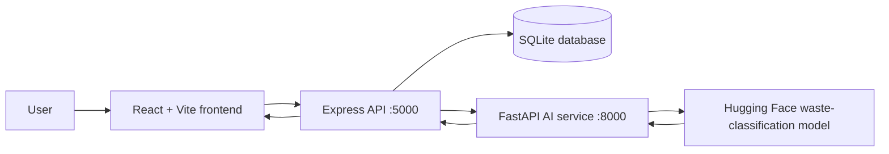

# EcoScan AI

An AI-assisted waste classification web application. Users can upload an image of a waste item, receive a predicted waste category and confidence score, and review their saved classifications, rewards, and reports.

> **Project status:** Academic / portfolio project. Run locally using the three services described below. Model predictions are automated estimates and should be checked before making disposal decisions.

## Contents

- [Overview](#overview)
- [Features](#features)
- [Technology stack](#technology-stack)
- [Architecture](#architecture)
- [Repository structure](#repository-structure)
- [Prerequisites](#prerequisites)
- [Local setup](#local-setup)
- [Application services](#application-services)
- [API overview](#api-overview)
- [Data and security notes](#data-and-security-notes)
- [Troubleshooting](#troubleshooting)
- [Future improvements](#future-improvements)

## Overview

EcoScan AI combines a React frontend, an Express API, a SQLite database, and a Python image-classification service. The AI service uses the Hugging Face model `watersplash/waste-classification`. The backend sends uploaded images to that service, maps the model label to an EcoScan waste category, and stores the result for the authenticated user.

The application currently maps classifications to categories including **Plastic, Paper, Glass, Metal, Organic, E-Waste**, and **Other / Unknown**.

## Application screenshot


## Features

- Account registration and login.
- Image upload for waste classification.
- AI prediction with a category and confidence score.
- Per-user scan history and access to saved scan images.
- Eco-points / reward transaction records for eligible classifications.
- Reports showing total scans and category distribution.
- Dashboard views, classification history, and waste-category guidance.

## Technology stack

| Area | Technologies |
| --- | --- |
| Frontend | React 19, Vite, JavaScript, CSS |
| Backend API | Node.js, Express |
| Database | SQLite via `better-sqlite3` |
| Authentication | JSON Web Tokens (`jsonwebtoken`), `bcryptjs` |
| Image upload | `multer` |
| AI service | Python, FastAPI, Uvicorn |
| Model inference | Hugging Face Transformers, PyTorch, Pillow |
| Icons | lucide-react |

## Architecture



1. The user signs in and uploads an image through the frontend.
2. The Express API verifies the JWT and validates the uploaded image.
3. The API forwards the image to the FastAPI `/predict` endpoint.
4. The Python service runs image classification and returns a label and confidence.
5. The backend maps the result to an application category and saves the scan.
6. The frontend displays the result and updates history / report views.

## Repository structure

```text
ecoscan-ai/
├── ai_server/
│   ├── main.py
│   └── requirements.txt
├── backend/
│   ├── db.js
│   ├── server.js
│   └── package.json
├── frontend/
│   └── src/
│       ├── App.jsx
│       ├── Auth.jsx
│       └── ...
├── public/
├── package.json
├── package-lock.json
├── vite.config.js
├── test-model.js
└── README.md
```

## Prerequisites

Install the following before starting:

- Node.js and npm.
- Python 3 and pip.
- A working Python environment capable of installing PyTorch and the packages in `ai_server/requirements.txt`.
- Internet access on the first AI-service start so the model can be downloaded.

## Local setup

Run each service in a **separate terminal** from the repository root.

### 1. Configure the backend

Create a file named `backend/.env`:

```env
JWT_SECRET=replace-this-with-a-long-random-secret
```

Use a unique secret for your local environment. Do not commit `.env` or real credentials.

Install backend dependencies and start the API:

```bash
cd backend
npm install
node server.js
```

The API listens at `http://localhost:5000`. The SQLite database is initialized by the backend code.

### 2. Start the AI service

Open another terminal:

```bash
cd ai_server
python -m venv .venv
```

Activate the virtual environment:

**Windows PowerShell**
```powershell
.\.venv\Scripts\Activate.ps1
```

**macOS / Linux**
```bash
source .venv/bin/activate
```

Install dependencies and start FastAPI:

```bash
pip install -r requirements.txt
uvicorn main:app --host 127.0.0.1 --port 8000
```

The model is downloaded when the service first starts. Wait for the startup message confirming that the model loaded. Check:

- Health endpoint: `http://127.0.0.1:8000/health`
- API documentation: `http://127.0.0.1:8000/docs`

The health response should show `"model_loaded": true` before image classification is attempted.

### 3. Start the frontend

Open a third terminal at the repository root:

```bash
npm install
npm run dev
```

Open the local URL printed by Vite (normally `http://localhost:5173`).

## Application services

| Service | Local address | Purpose |
| --- | --- | --- |
| Frontend | `http://localhost:5173` | User interface |
| Express API | `http://localhost:5000` | Authentication, scans, rewards, reports |
| FastAPI AI | `http://127.0.0.1:8000` | Image classification |

All three services must be running for the complete image-classification workflow.

## API overview

The backend currently defines these routes:

| Method | Endpoint | Purpose |
| --- | --- | --- |
| POST | `/api/auth/signup` | Register an account |
| POST | `/api/auth/login` | Authenticate and receive a JWT |
| GET | `/api/auth/me` | Get the authenticated user |
| POST | `/api/scans` | Upload and classify an image |
| GET | `/api/scans` | Retrieve the user's scan history |
| GET | `/api/scans/:id/image` | Retrieve a saved scan image |
| GET | `/api/rewards` | Retrieve reward information |
| GET | `/api/reports` | Retrieve classification report data |

The AI service exposes:

| Method | Endpoint | Purpose |
| --- | --- | --- |
| GET | `/health` | Service and model readiness |
| POST | `/predict` | Classify an uploaded image |

## Data and security notes

- The backend requires `JWT_SECRET` in `backend/.env`; keep this file private.
- The backend uses bcryptjs for password hashing and JWT authentication.
- Uploaded images and the local SQLite database are runtime data. Do not commit private user data, database files, uploads, environment files, or model/cache files.
- The AI service accepts image uploads up to 5 MB and currently allows common image formats.
- Model confidence is a model score, not a guarantee that a classification is correct.
- Before production deployment, review authorization, upload validation, rate limiting, secret management, database backups, and data-retention behavior.

## Troubleshooting

**The frontend says the AI service is unavailable**
- Confirm the FastAPI terminal is running on port 8000.
- Open `http://127.0.0.1:8000/health` and check that the model is loaded.

**The AI model is still loading**
- The model is downloaded on first startup. Wait for the successful model-loaded message and check your internet connection.

**Login or API requests fail**
- Confirm the Express API is running on port 5000.
- Confirm `backend/.env` contains `JWT_SECRET`, then restart the backend.

**The frontend cannot connect**
- Start the frontend, backend, and AI service in separate terminals and check the configured local ports.

## Future improvements

- Add automated tests for authentication, scan processing, and report endpoints.
- Add clearer model evaluation metrics and explain classification limitations.
- Improve deployment configuration and environment-based service URLs.
- Add CI checks and documented release / deployment steps.
- Add accessibility and responsive-interface checks.
